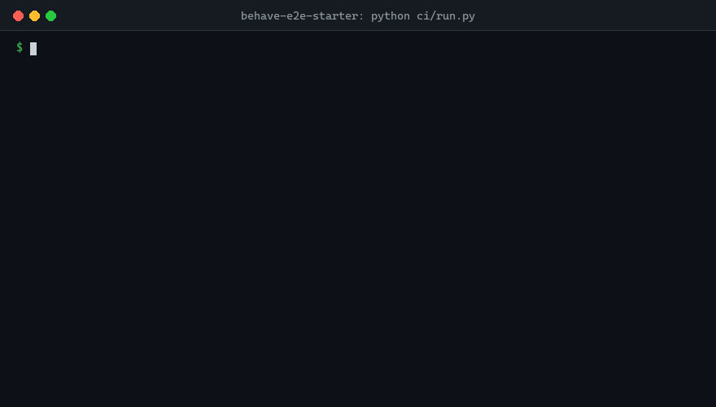

<div align="center">

<picture>
  <source media="(prefers-color-scheme: dark)" srcset="docs/reader-dark.svg">
  
</picture>

# behave-e2e-starter

**End-to-end tests in plain sentences.** Gherkin scenarios, run by [behave](https://behave.readthedocs.io), against
REST APIs, file transfer, SAP IDocs and Workato: offline in seconds, and the same scenarios against a real landscape.

[](https://github.com/makavli/behave-e2e-starter/actions/workflows/check.yml)


[](LICENSE)

[Run it](#run-it) · [Make it yours](#make-it-yours) · [Schedule a video](#schedule-a-video-on-your-own-channel) · [AI agents](#with-an-ai-coding-agent) · [Pipelines](#pipelines) · [Secrets](#secrets-openbao-a-free-stand-in-for-azure-key-vault)

</div>

<p align="center">
  
</p>

| Plain sentences | Offline in seconds | Costs nothing |
|---|---|---|
| A scenario anyone on the team can read is the spec; each sentence runs as one small Python step. | Built-in stand-ins for every system: the whole inventory runs in about 5 s, with no network and no accounts. | Free tools only: GitHub Actions on a public repository, a self-hosted Azure DevOps agent, OpenBao for secrets. |

## A scenario is the spec

```gherkin
@api
Feature: Order API
  Background:
    Given the JSON payload
      """
      {
        "external_ref": "{{cid}}",
        "currency": "EUR",
        "items": [{"material": "MAT-100", "quantity": 2, "unit": "PCE"}]
      }
      """

  @smoke
  Scenario: Create an order and read it back
    When I POST the payload to "/orders"
    Then the response status is 201
    And the response body matches the "order" schema
    And the response field "external_ref" is "{{cid}}"
```

Each sentence is one small Python function, in [`features/steps/api_steps.py`](features/steps/api_steps.py):

```python
@when('I {method:w} the payload to "{path:S}"')
def call_with_payload(context, method, path):
    _call(context, method, path, body=context.payload)


@then("the response status is {code:d}")
def status_is(context, code):
    r = context.response
    assert r.status_code == code, f"expected HTTP {code}, got {r.status_code}: {r.text[:500]}"
```

## What it covers

One inventory covers four integration patterns, plus the flows that cross them:

| Tag | Pattern | What the scenarios prove |
|---|---|---|
| `@api` | REST API | create and read back, JSON-schema contract, search, idempotent replay, auth refused, invalid input rejected with a reason, 404, response-time budget |
| `@mft` | Managed file transfer (SFTP or a drop folder) | delivery byte for byte (text, UTF-8, binary up to 1 MB), archive, SHA-256 checksum sidecar, wrong checksum / empty file / refused file type go to the error folder |
| `@idoc` | SAP IDoc (IDoc-XML, ORDERS05) | control record and segment checks before sending, posting (status 53), application error (status 51), malformed XML refused |
| `@workato` | Workato recipe | webhook starts a job, the jobs API shows it succeeded, or failed with a reason; forged signature refused |
| `@e2e` | Cross-pattern | IDoc → order API, Workato webhook → order API, IDoc file across MFT |
| `@api @live` | A real third-party API (YouTube Data API v3) | a key read from OpenBao at run time works, a wrong key and no key are refused, the response matches its contract |
| `@api @live` | Your own YouTube channel (OAuth, refresh token in OpenBao) | a private upload is processed, a caption track is added and listed (accessibility); a vertical clip under 3 minutes (a Short) keeps its shape; every upload is deleted afterwards |
| `@api @sap` | SAP S/4HANA sales order API (`API_SALES_ORDER_SRV`, OData V2) behind an API gateway | `$metadata`, collections with `$top` / `$inlinecount` / `$filter` / `$select`, read by key, `to_Item` navigation, Gateway error bodies (404, 400), the gateway's API-key faults (Apigee `fault.detail.errorcode`) |

Every scenario runs **offline** against built-in simulators, except the `@live` ones, which call a real service and
run only when their key is there. The **same scenarios** run against a real landscape once a config file points at
it: nothing in the features changes. Everything here is free: no paid service, no hosted minutes.

## Run it

Python 3.11 or newer, 64-bit (on Windows, `py -3-64`; on macOS and most Linux, `python3`; on Debian or Ubuntu, also
`sudo apt install python3-venv`, which `ci/run.py` needs to make its `.venv`). `.github/workflows/check.yml` runs
the same command on Windows, Ubuntu and macOS for every pull request. From the repository root:

```bash
python ci/run.py                               # everything, against the local simulators (about 5 s)
python ci/run.py --secrets                     # the same, plus the @live scenarios, with keys from OpenBao
python ci/run.py --publish my-short            # upload content/my-short to your channel and keep it (below)
python ci/run.py --tags "@smoke"               # the smoke suite only
python ci/run.py --tags "@mft and not @negative"
python ci/run.py --env dev --tags "@api"       # against config/dev.toml
python ci/run.py --inventory                   # print the inventory table, run nothing
python ci/run.py -- --stop -D timeout_s=300    # anything after -- goes to behave
```

`ci/run.py` makes its own `.venv` from `requirements.txt` and then runs three steps. The first failure stops it:

1. **inventory check**: every scenario carries one pattern tag and one suite tag (`reports/inventory.md`);
2. **framework self-tests**: `tests/` (config, waits, JSON paths, IDoc rules, MFT folders, the inventory check,
   secrets and masking);
3. **behave**, with JUnit results in `reports/junit/` and Allure results in `reports/allure-results/`. Any secret
   value found in `reports/` afterwards is replaced with `***` and fails the run.

Plain `behave` works too, once the requirements are installed: `behave -D env=local --tags @smoke`.

## Make it yours

1. Use this repository as a template (or fork it), clone it, and run `python ci/run.py`: it should be green before
   you change anything.
2. Write your own scenarios (see "Writing scenarios"), or point the existing ones at your systems ("Real
   environments").
3. For the `@live` YouTube scenarios: install OpenBao (below), store an API key from Google Cloud
   (`bao.py put behave/youtube api_key`), and run `python ci/run.py --secrets`.
4. To upload to your own channel, and to schedule what you upload: the next section.

## Schedule a video on your own channel

One command uploads a folder to your channel as a private video, adds its captions and hands YouTube the hour to
publish it. From then on YouTube does the rest: your computer can be off.

1. **A Google OAuth client.** In the [Google Cloud console](https://console.cloud.google.com), make a project and
   enable *YouTube Data API v3*. Under *Google Auth platform*, set the app up for *External* users and add your own
   Google account under *Audience* > *Test users*; under *Clients*, create a client of type *Desktop app*.
2. **The secret store.** `python ops/openbao/bao.py install`, then store the client's two values (hidden prompts):
   `python ops/openbao/bao.py put behave/youtube-oauth client_id`, and the same with `client_secret`. On Windows,
   run `put` in PowerShell or the VS Code terminal (Git Bash cannot hide the prompt). `install` downloads the
   Windows build: on Linux or macOS, put the OpenBao binary at `~/.openbao/bin/bao` first. After a reboot,
   `python ops/openbao/bao.py start`.
3. **Your consent.** `python ops/openbao/google_oauth.py behave/youtube-oauth` opens Google's consent page: sign in
   with the account that owns the channel. The refresh token goes into OpenBao and is never shown.
4. **Your channel's id** (`UC...`, shown at youtube.com/account_advanced), as `channel_id` under `[youtube_owner]`
   in `config/local.toml`. Every upload first checks that the token acts for that channel, and refuses otherwise.
5. **A folder**, `content/my-short/`, with `video.mp4`, `captions.en.vtt` and a `meta.toml`:

   ```toml
   title = "My first scheduled Short #Shorts"
   description = "Posted by one command."
   tags = ["shorts"]
   language = "en"
   publish_at = 2027-01-04T18:00:00+01:00   # unquoted, with your UTC offset, at least an hour ahead

   [captions]
   en = "English"
   ```

6. **Publish it:** `python ci/run.py --publish my-short`. The run uploads the video private, waits until YouTube
   has processed it, checks that YouTube stored exactly that hour, adds the captions and checks they are listed,
   then keeps the video. A step that fails deletes the upload, and a run that uploaded nothing ends red.

The file names are fixed: `video.mp4`, `meta.toml`, and one `captions.<code>.vtt` for each `<code>` under
`[captions]`; `title`, `description` and `language` are required. A vertical or square video of at most 3 minutes
is a Short. Without `publish_at`, the video stays private until you pick its visibility in YouTube Studio; without
`[captions]`, no caption file is needed. `content/test-short` is a 3-second example to try first. While the Google
app's publishing status is "Testing", your consent lasts seven days: run step 3 again each week, or publish the app
(see "Limits").

## With an AI coding agent

An agent may say "done" without running the check. `ci/stop_check.py` is a Claude Code Stop hook that runs
`python ci/run.py` whenever the agent tries to finish: while it is red, the agent gets the check's last lines and
keeps working (4 times at most, then it may stop). Install it with:

```bash
mkdir -p .claude && cp ci/claude-settings.json .claude/settings.json   # or merge its "hooks" into yours
```

Where `python` is not on PATH (macOS, some Linux), change it to `python3` in `.claude/settings.json`. The same
works with a free local model: Claude Code pointed at a model served by [Ollama](https://ollama.com). Give the model
a large context window (Ollama's default is small); the hook, not the model, decides when the work is done. A person
still reviews and merges.

## The inventory and its tags

| Tag | Meaning |
|---|---|
| `@api` `@mft` `@idoc` `@workato` `@e2e` | the pattern: exactly one per scenario |
| `@smoke` `@regression` | the suite: exactly one per scenario |
| `@negative` | the scenario proves something is refused or fails cleanly |
| `@live` | calls a real external service (`--tags "not @live"` keeps a run fully offline) |
| `@requires.<section>.<key>` | runs only when that config key is set, otherwise skipped with the reason |
| `@wip` | left out by default |
| `@publish` | publishes the `content/<name>` folder named by `ci/run.py --publish <name>` or by the pipeline's `publish` input, and keeps it; skipped when none is named |
| `@keep` | leaves what it made in place (a kept YouTube upload); left out unless named: `--tags @keep` |

A scenario whose pattern has no section in the config (`[workato]`, for example) is skipped too, so a landscape
without Workato runs the rest unchanged. Behave tag expressions combine all of these:
`--tags "@smoke and (@api or @idoc)"`.

## Real environments

1. Copy `config/example.toml` to `config/<env>.toml` (`dev.toml`, `test.toml`...). Every key is explained there.
2. Write secrets as `${NAME}`: they are read from environment variables (pipeline secrets), never stored in the file.
   A section is resolved only when a scenario uses it, so an `@api` run needs only the API's secrets.
3. Leave out what the landscape does not have: no `archive` folder means the archive scenario is skipped, no `[flows]`
   entry means that cross-pattern flow is skipped.
4. `python ci/run.py --env dev`.

<details>
<summary><b>What each pattern expects from a real landscape</b></summary>

- **API**: bearer token, basic auth or OAuth2 client credentials; extra headers (an API-management key, for example);
  TLS verification on by default, or a company CA bundle. GETs are retried on 429/502/503/504.
- **MFT**: SFTP with a key or a password, the host key checked against `known_hosts` (an unknown or changed key is
  refused: there is no "trust on first use"). Uploads are written as `.part` and then renamed; set
  `atomic_upload = false` where the server forbids renames. Each run removes its own files (`cleanup = true`).
- **IDoc**: IDoc-XML posted to `endpoint` (SAP `/sap/bc/idoc_xml`, a CPI iFlow or a middleware listener). The status
  scenarios need a `status_url` that returns the IDoc's status as JSON (an OData service over EDIDS, or the middleware's
  monitoring API); `status_field` says where the status sits. SAP numbers every inbound IDoc itself, so the URL finds
  the IDoc by the order reference (`{ref}`), or by `{docnum}` read from the send answer (`docnum_field`).
- **Workato**: the recipe's webhook URL, plus an API client token for the jobs API. The job must show the event's
  `correlation_id` in its jobs-API record (its title or a job-report column): that is how each scenario finds its own
  job among everyone else's.
- **Any other REST API**: a section of its own (`[youtube]`, for example) with the same keys as `[api]`, then
  `Given the "youtube" API` in the scenario. An API key (`api_key`, `api_key_header`) is sent in a header, never in
  the URL, so it stays out of logs and error messages. A user's own data takes their OAuth consent: `token_url`,
  `client_id`, `client_secret` and a `refresh_token` (`[youtube_owner]` in `config/local.toml`; `upload_url` for
  media uploads). Its `channel_id` is a guard: every upload first asks which channel the token acts for and refuses
  unless it is that one, so a re-consent with the wrong Google account uploads nothing.
- **SAP OData behind Apigee**: `[sap]` with the service's `base_url` and the gateway's key header. Locally it is a
  simulator; point `[sap]` at your own S/4HANA through Apigee the same way. If an AI agent starts your runs, read
  SAP's API Policy first: it restricts AI systems that execute SAP API calls.

</details>

Isolation: each scenario gets a fresh correlation id `{{cid}}` (and a 16-digit `{{docnum}}`), used in order references,
file names and events. Runs never read each other's data, even on a shared environment.

## Pipelines

The pipelines call the same `ci/run.py` as a laptop does.

**GitHub Actions** (`.github/workflows/check.yml`): every pull request and every push to `main`, offline, on
Windows, Ubuntu and macOS. Hosted runners are free on a public repository.

**Azure DevOps** (`azure-pipelines.yml`) runs **only when started by hand** (Pipelines > Run pipeline), and **only on
a self-hosted agent** in pool `Default` (your own machine): no hosted minutes are ever used, so it costs nothing.

| | |
|---|---|
| Inputs | `environment`, `tags`, `secrets` (read them from OpenBao, on by default), `publish` (a `content/` folder to publish, `none` by default) |
| Runs on | pool `Default` (self-hosted), 64-bit Python (`py -3-64` on Windows) |
| Results | Tests tab (JUnit), Allure Report tab (the free "Allure Report" extension), `e2e-reports-<attempt>` artifact |
| Secrets | OpenBao on the agent machine; nothing secret is stored in Azure DevOps |

With no agent online, a started run waits in the queue; it never falls back to a hosted one.

## Secrets: OpenBao, a free stand-in for Azure Key Vault

[OpenBao](https://openbao.org) (the Linux Foundation's open-source fork of HashiCorp Vault) runs on the agent machine,
reachable from that machine only. `ops/openbao/bao.py` (standard library only) installs and runs it:

```bash
python ops/openbao/bao.py install                      # once: download (SHA-256 pinned), configure, start, set up
python ops/openbao/bao.py put behave/youtube api_key   # store a secret: hidden prompt, the value is never shown
python ops/openbao/bao.py start | stop | status        # after a reboot: start (it unseals itself)
python ops/openbao/bao.py autostart [off]              # or start it at every sign-in, hidden (Windows, no admin)
python ops/openbao/google_oauth.py behave/youtube-oauth  # your Google consent, stored as a refresh token
```

Run `put` in PowerShell or the VS Code terminal: Git Bash's own window (mintty) cannot hide the prompt.

`google_oauth.py` needs an OAuth client of type "Desktop app" from Google Cloud, stored first with
`bao.py put behave/youtube-oauth client_id` and `... client_secret`. It opens Google's consent page, takes the answer
on 127.0.0.1 (PKCE), and stores the refresh token without showing it.

How a run gets its secrets, like the Azure Key Vault task does:

1. `ci/run.py --secrets` (the pipeline's `secrets` input) logs in with the AppRole `behave-ci`, from
   `~/.openbao/behave-ci.json` on the agent machine. That role can only **read** `secret/behave/*`, only from
   127.0.0.1, and its tokens live 10 minutes at most.
2. It reads every `[secrets]` entry of the config (`NAME = "<path>#<field>"`) into an environment variable. A
   trailing `?` makes one optional: while it is not stored, the variable stays unset and its scenarios are skipped.
3. On an agent, each value is first registered with `##vso[task.setsecret]`: Azure masks it as `***` in every log
   line after. Then the token is revoked.
4. The config uses the variable as usual: `api_key = "${YOUTUBE_API_KEY:-}"`. Azure Key Vault fits the same slot: its
   pipeline task turns secrets into secret variables, which a step maps (`env:`) to the same environment variables.

`~/.openbao` (your account only) holds the server, its data, `unseal.key` (it unseals itself on start), `root-token`
(used only by `put`), `recovery-key.txt`, `behave-ci.json` and `audit.log` (every request, values hashed).

## Writing scenarios

- Put the feature under `features/<pattern>/`; tag it with its pattern, and each scenario with `@smoke` or `@regression`.
- Steps are in `features/steps/<pattern>_steps.py`; `python ci/run.py --inventory` shows where every scenario stands.
- Text in steps and doc strings can use `{{cid}}`, `{{docnum}}` and any value saved with
  `I remember the response field "id" as "order_id"`.
- Anything that happens later (a job, a file, a status) is checked with `context.e2e.eventually(...)`: it polls until
  `timeout_s` and then fails with the last thing it saw.
- A new IDoc basic type: add it to `TYPES` in `e2e/idoc.py`, with its message types and mandatory segments.

## Layout

```
features/            the inventory: one folder per pattern, steps/ and environment.py (hooks)
e2e/                 the framework: config, clients (api, mft, idoc, workato), waits, inventory, secrets
e2e/sim/             local simulators: order API, IDoc endpoint, SAP sales order OData, Workato recipe + jobs API,
                     SFTP server, MFT route
config/              local.toml (simulators), example.toml (template for a real landscape)
testdata/schemas/    JSON schemas the API contract is checked against
testdata/media/      the tiny clips and captions the YouTube upload scenarios send (3 s each)
content/<name>/      a video to publish: video.mp4, captions.<language>.vtt, meta.toml (title, description, tags...,
                     optional publish_at = 2027-01-04T18:00:00+01:00: YouTube makes it public then);
                     content/test-short is the example the publish scenario uploads
tests/               framework self-tests
ci/run.py            the one entry point for laptops and pipelines
ci/stop_check.py     the Stop hook for AI agents (ci/claude-settings.json installs it)
ops/openbao/bao.py   installs and runs OpenBao, the secret store on the agent machine
ops/openbao/google_oauth.py  stores a Google OAuth refresh token in OpenBao
docs/                the figure and the terminal recording at the top of this README
```

## Limits

- IDocs are IDoc-XML only; flat-file IDocs (fixed-width records) need a parser first (`e2e/idoc.py`).
- The local IDoc endpoint reuses the framework's own IDoc rules; against a real SAP, SAP decides.
- The SAP OData simulator follows Gateway conventions; only the no-key fault is taken from a live system, so the first
  run against a real one is what confirms the rest (error codes, `$select` output, data).
- The YouTube API has no Shorts field: a vertical or square video up to 3 minutes is a Short, so the scenario checks
  the shape (`fileDetails`), not a flag. While the Google app's publishing status is "Testing", its refresh tokens
  expire after 7 days: run `google_oauth.py` again, or publish the app (In production) and accept the unverified-app
  screen once. Each run costs about 550 of the 10,000 daily quota units, plus 2 of the 100 daily uploads.
- Scenarios run one after another (behave has no parallel mode); the correlation ids already make parallel
  pipeline runs on one environment safe.
- OpenBao here is one node for one machine. Its unseal key sits beside its data, so the store is exactly as safe as
  your account: the point is no secret in the repo, in a pipeline or in a log. The agent runs as your account too, so
  a pipeline could read `~/.openbao`: run only pipelines you trust, or run the agent as its own user and give that
  user only `behave-ci.json`. The AppRole's secret_id does not expire; to replace it, delete `behave-ci.json` and
  create a new one from the root token (`auth/approle/role/behave-ci/secret-id`).

## License

MIT, see `LICENSE`.
